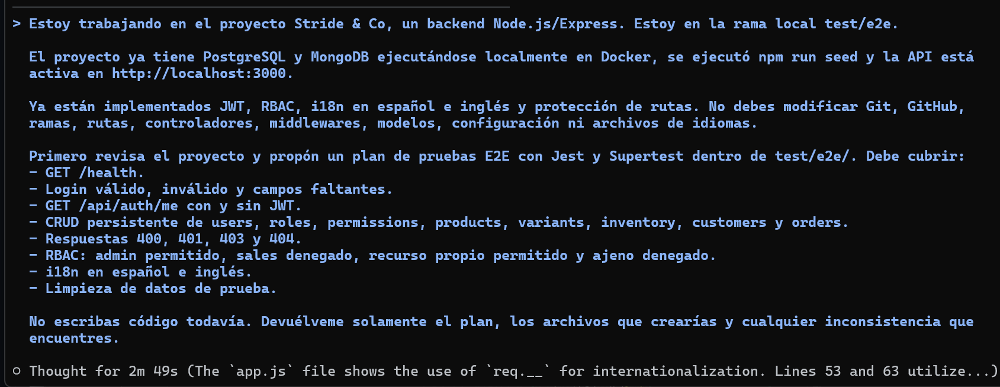
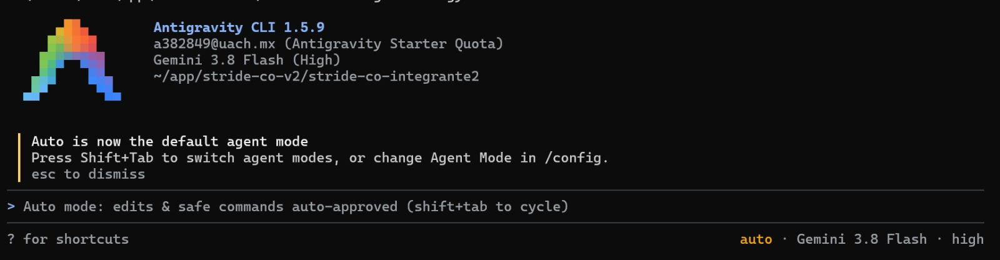
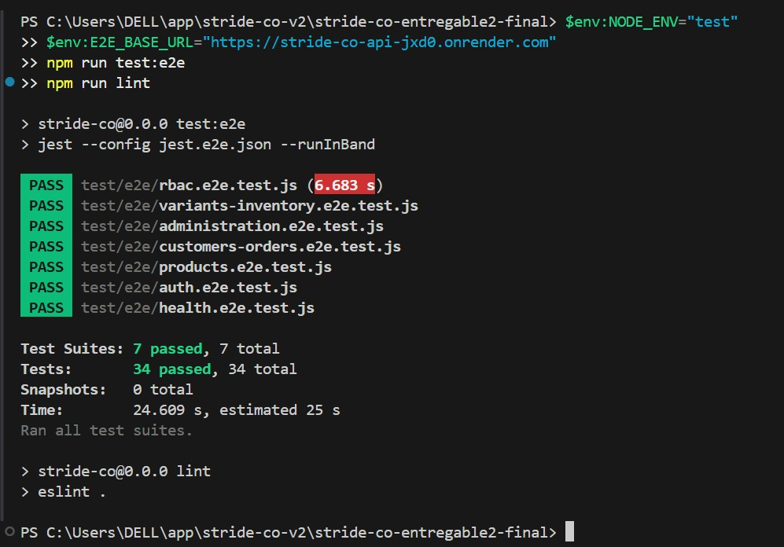
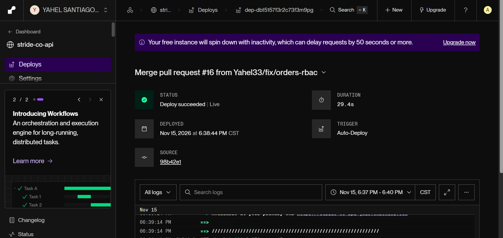

# Evidencia de pruebas E2E con Google Antigravity

## Objetivo

Validar la API desplegada en Render mediante pruebas E2E contra servicios reales: PostgreSQL en Render y MongoDB Atlas.

URL probada:

```text
https://stride-co-api-jxd0.onrender.com
```

## Ejecucion

```powershell
$env:NODE_ENV="test"
$env:E2E_BASE_URL="https://stride-co-api-jxd0.onrender.com"
npm run test:e2e
npm run lint
```

Resultado final:

```text
Test Suites: 7 passed, 7 total
Tests: 34 passed, 34 total
```

## Uso de Antigravity

Antigravity se utilizo para generar borradores de las suites E2E de autenticacion y RBAC. Los borradores fueron revisados manualmente antes de agregarlos al repositorio.

### Suite de autenticacion

Objetivo solicitado:

- Login correcto devuelve token.
- Credenciales invalidas devuelven 401.
- Mensajes traducidos en espanol e ingles.
- Campos requeridos devuelven 400.
- Las respuestas no exponen token cuando el login falla.

Revision aplicada:

- Se corrigieron caracteres con codificacion incorrecta.
- Se validaron los mensajes con `locales/es.json` y `locales/en.json`.
- Se verifico que las respuestas fallidas no expongan token.

Commit relacionado:

```text
test(e2e): add auth suite (generated with antigravity, reviewed)
```

### Suite RBAC

Objetivo solicitado:

- Admin elimina productos temporales.
- Sales no puede eliminar productos.
- User consulta una orden propia.
- User no puede consultar una orden ajena.
- User no puede listar todas las ordenes.

Revision aplicada:

- Se detecto que el borrador usaba `salesPersonId` como propiedad de una orden.
- Se corrigio la implementacion para validar la propiedad con `Order.customerId -> Customer.userId`.
- Se protegio `DELETE /api/orders/:id` con autenticacion y `orders:delete:any`.
- Las pruebas crean y eliminan datos temporales para no modificar los datos seed.

Commit relacionado:

```text
test(e2e): add rbac suite (generated with antigravity, reviewed)
```

## Cobertura E2E final

- Health check y rutas protegidas.
- Autenticacion y mensajes ES/EN.
- Autorizacion RBAC para admin, sales y user.
- CRUD de productos.
- CRUD de clientes y ordenes.
- CRUD de variantes e inventario.
- CRUD de roles y permisos.
- Verificacion de que usuarios no exponen `password_hash` ni `salt_key`.

## Capturas requeridas para el entregable

1. Sesion de Antigravity mostrando la generacion o ejecucion de una suite E2E.
2. Terminal con `npm run test:e2e` y las 34 pruebas aprobadas.
3. Render mostrando el servicio en estado Live.
4. Pruebas contra la URL de Render, incluyendo `/health`, login y una respuesta 403 de RBAC.

No se deben incluir tokens, contrasenas, URIs privadas ni archivos de configuracion secretos en las capturas.

## Evidencias incluidas

### Prompt y plan E2E en Antigravity



### Sesion de Antigravity con cuenta UACH



### Resultado final de pruebas E2E



### Despliegue en Render


