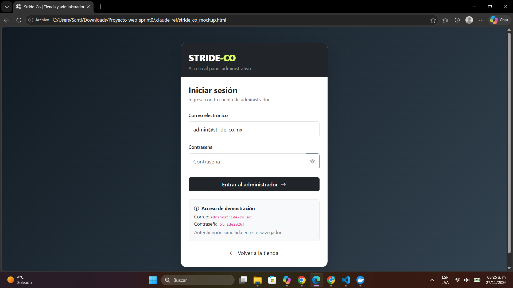
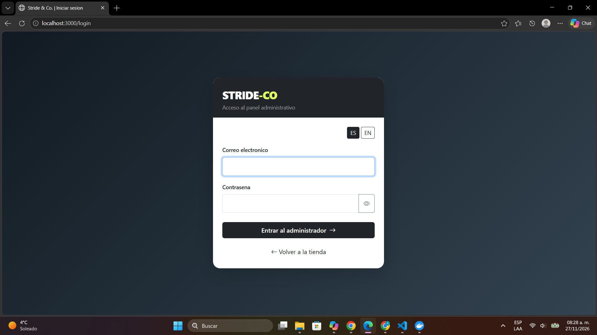
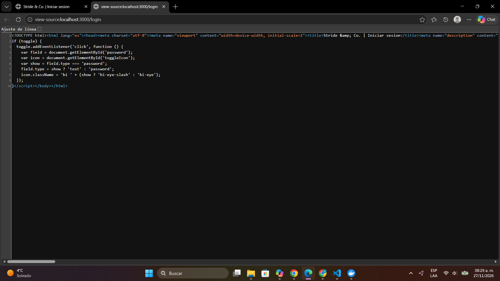

# Evidencia SSR

Capturas de cada funcionalidad SSR: el prototipo original, la implementacion en el navegador y el codigo fuente (Ver codigo fuente / Ctrl+U) donde se ven los datos generados en el servidor.

## F1. Inicio y cierre de sesion

| Prototipo | Implementacion |
| --- | --- |
|  |  |

Codigo fuente:

